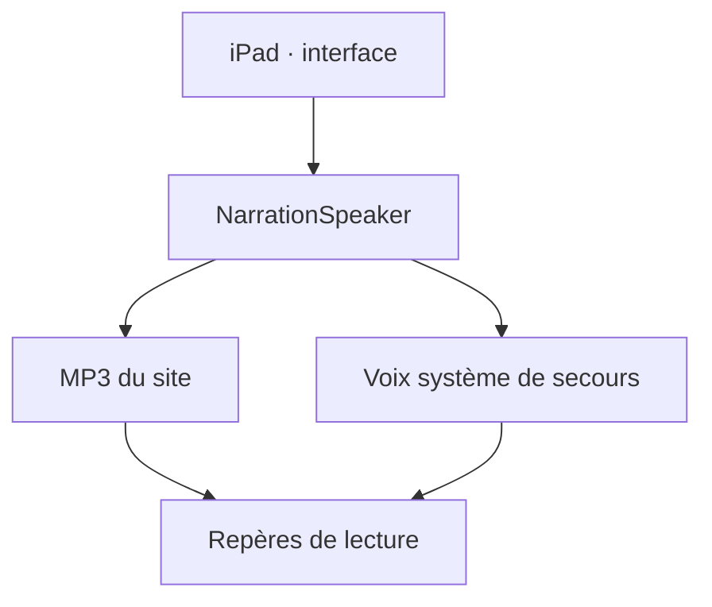

# Architecture de l’Atelier des mots

Référence technique au 21 octobre 2026. État opérationnel daté : [PROJECT-STATE](ops/PROJECT-STATE.md). Accès et exploitation : [ACCESS-RUNBOOK](ops/ACCESS-RUNBOOK.md).

## Périmètre et hébergement

| Élément | Référence | Rôle |
|---|---|---|
| Dépôt actif | Lianag2018/educ-ecole, main | Source de l’application personnelle |
| Site | https://educ-ecole.vercel.app | Interface et endpoints API sur la même origine |
| Équipe Vercel | lianag2018s-projects | Hébergement personnel |
| Projet Vercel | educ-ecole | Projet de production, pas educ-ecole-famille |
| Supabase personnel | Identité distante à vérifier | Auth parent, sauvegardes et budget vocal prévus |
| Render personnel | Service actif non confirmé | Aucune dépendance Render démontrée pour la lecture publiée |
| Ancienne source | kenebec-ai/projects/lecture-famille | Provenance historique, pas source active |

Aucun besoin de MongoDB n’est établi dans le code actuel. Ne pas créer une deuxième base ou un deuxième hébergement pour résoudre un défaut d’accès.

## Parcours de lecture

- `src/app.js` : navigation, profils, activités, réponses, commandes audio et affichage.
- `src/engine.js` : sélection/révision et persistance locale. `src/learning.js` : différenciation des niveaux scolaires.
- `src/content.js`, `garden.js`, `unicorn-stories.js`, `week-plan.js` : activités, histoires et plan scolaire; `numbers.js` : nombres.
- `src/narration.js` : MP3 publics déjà générés, annulation des callbacks anciens, voix système si fichier absent.
- `src/speech.js` : lecture native fr-CA et suppression du séparateur « + » uniquement pour les syllabes.
- `src/guided-reading.js` : ponctuation, liaisons choisies, surlignage piloté par le média; estimation pour MP3, événements de mots lorsqu’une voix native les fournit.
- `src/style.css` : interface et effets; respecte la réduction des animations. `icons/accueil-famille.png` : accueil illustré conservé.

Les profils p1 (1re année) et p2 (3e année) ont des activités et progrès distincts. La plage de nombres demandée au profil avancé est 0–1 999. Le plan scolaire peut demander une plage plus large; ne pas annoncer cette extension tant qu’elle n’est pas implémentée.

## Production de la narration

`ops/build.mjs` construit `dist`, puis `ops/generate-narration.mjs` utilise le catalogue borné de `ops/narration-catalog.mjs`. La génération payante n’est autorisée par ce code qu’en build Vercel de production sur main. Elle réutilise les fichiers existants; ne pas lancer plusieurs builds payants simultanément.

Le catalogue connu comprend 395 clips, modèle/voix et instructions fixés dans le code. `/audio/manifest.json` associe textes pédagogiques et fichiers. `/audio/status.json` indique ready/partial/unavailable et les compteurs. Un clic sur Écouter lit un fichier existant; il ne génère pas une nouvelle facture OpenAI. Les textes privés importés ne deviennent pas automatiquement des MP3 publics.

## Conversation et données

La conversation libre est distincte de la lecture :
`src/conversation.js` → endpoints `api/parent/*` et `api/voice/*` → `ops/server/runtime.mjs` → vérification parent, budget durable et fournisseur.

Les modules `session.mjs`, `budget.mjs`, `turn.mjs`, `provider.mjs`, `pedagogy.mjs` portent les responsabilités serveur. Les migrations `ops/supabase/001-parent-backups.sql` et `002-voice-budget.sql` sont préparées; leur présence ne prouve pas leur application distante. Voir VOICE-SETUP pour les variables et conditions exactes.

| Donnée | Conservation actuelle / limite |
|---|---|
| Profils, progrès, cartes locales | localStorage du navigateur; pas de synchronisation automatique démontrée |
| Enregistrement pour réécoute | Mémoire locale, libéré à la sortie; pas une évaluation automatique |
| MP3 narratrice | Fichiers publics de textes intégrés |
| Secrets fournisseur | Environnement serveur/build uniquement |
| Budget conversation | SQL durable requis avant activation; plafond configuré 40 CAD/mois |
| Audio/transcription conversation | Traitement serveur conditionnel; protections et rétention à vérifier avant usage réel |

Installation sur écran d’accueil via manifest et icônes; aucun service worker ni fonctionnement hors ligne garanti.

## Validation et livraison

`npm test` et `npm run build` constituent les contrôles locaux. Les tests SQL exigent une base jetable explicitement identifiée; ne pas lancer des fixtures sur la base familiale. Les tests mock ne prouvent ni l’acoustique réelle ni une configuration distante.

Publier l’application complète avec ses fonctions API, pas seulement une ancienne preview statique. Confirmer projet/équipe/SHA, état du build, HTTP des ressources, lecture réelle et interruption. Mettre les preuves dans PROJECT-STATE sans secrets. Conserver la version de production précédente pour retour arrière; ne pas réinitialiser les données des enfants.

## Mémoire pédagogique — ajout du 21 octobre 2026

`src/progress.js` recalcule un portrait par profil depuis l’historique existant : fenêtres de sept jours, réussites sans aide, aides, reprises et prochaine étape. La classification de consolidation exige plusieurs jours et cartes; les répétitions du même jour/carte sont regroupées pour cette classification. Il s’agit de règles explicites, pas d’un diagnostic ni d’une IA qui se réentraîne.

Les nouvelles réponses incluent la matière et le niveau de l’activité. Les réponses Maths/Univers social ne changent plus le palier de lecture. Les anciennes réponses sans matière restent conservées et signalées non classées dans le bilan; la compatibilité de leur ancien calcul de niveau est conservée. La mission de français classe les domaines selon les besoins, tout en gardant les échéances et limites existantes. Les matières ouvertes explicitement commencent par les reprises dues, puis les nouveautés, sans retirer de contenu ni changer l’année scolaire. Cette adaptation utilise la banque existante, sans générer de nouveaux exercices.

Le bilan est recalculé après les réponses lors de son affichage et ne nécessite aucun appel réseau. Persistance locale existante, pas de synchronisation distante livrée. Pas de mise à jour autonome du code : les changements logiciels restent testés et revus.

## Jardin des sons — préparation locale du 22 octobre 2026

`src/sound-garden.js` fournit les 36 cartes. `src/phoneme-player.js` joue exclusivement les MP3 importés de Laval, à vitesse originale, et invalide les événements des lectures précédentes. `icons/phonemes/sources.json` conserve la provenance et les empreintes des fichiers; le build les copie avec les icônes. Aucun service payant, microphone ou synthèse de phonème n’est appelé. Les récompenses d’effort restent distinctes de la maîtrise en lecture. État de validation et de publication dans PROJECT-STATE.

## Sprint et plans photographiés — 22 octobre 2026

`src/speed-math.js` : dix cartes, trois choix uniques, temps actif monotone, pause sur changement d’onglet. Trois paliers (20/15/10 secondes indicatives). Cinq réussites dont quatre dans le repère permettent une montée; deux erreurs/aides ou trois lenteurs dans un bloc de cinq permettent une baisse. Jamais d’échec automatique au délai. Résultats séparés dans chaque profil; pas de diagnostic de maîtrise.

`src/math-speech.js` normalise nombres et calculs simples en mots français. `56 − 20` devient « cinquante-six moins vingt ». Les instructions de narration ont été révisées pour toute la banque, avec un complément numérique. Les fichiers ont une nouvelle empreinte; la publication doit confirmer 1 132 clips. L’existence d’un MP3 ne prouve pas à elle seule la qualité acoustique.

`src/school-plan.js` : formulaire photo, réduction JPEG locale (1 600 px), extraction limitée aux notions, plans datés isolés par profil, génération déterministe de calculs et cartes de mots et sélection de contenus d’univers social déjà préparés. Les thèmes non pris en charge et pages manquantes sont affichés explicitement. Il n’y a ni import automatique des livres CEC, ni renouvellement autonome du code.

`ops/server/plans.mjs` et `/api/plans/import`, `/api/plans/list` : parent authentifié, profil détenu, consentement par photo, configuration de rétention vérifiée, budget durable partagé, requête OpenAI à endpoint fixe (aucun outil), sortie structurée validée puis sauvegarde privée. Une réserve prudente de 1 CAD par import (pas le coût réel) reste comptabilisée; les requêtes répétées dont le résultat est sauvegardé utilisent le cache. Pas de nouvelle tentative payante automatique. Au plus 12 plans par profil. Photo non conservée par l’app; la rétention fournisseur dépend de la configuration vérifiée.

**Activation non démontrée** : schéma `ops/supabase/school-plans-schema.sql` proposé, non appliqué. Exige les profils et le budget existants, les variables personnelles et `plansEnabled:true` dans la configuration uniquement après vérification effective des conditions. Aucune valeur de consentement/rétention ne doit être falsifiée. Connexion parent indépendante de la disponibilité vocale. Les plans peuvent être récupérés sur un autre appareil une fois le service configuré; les historiques de réponses restent locaux, sans synchronisation automatique.
