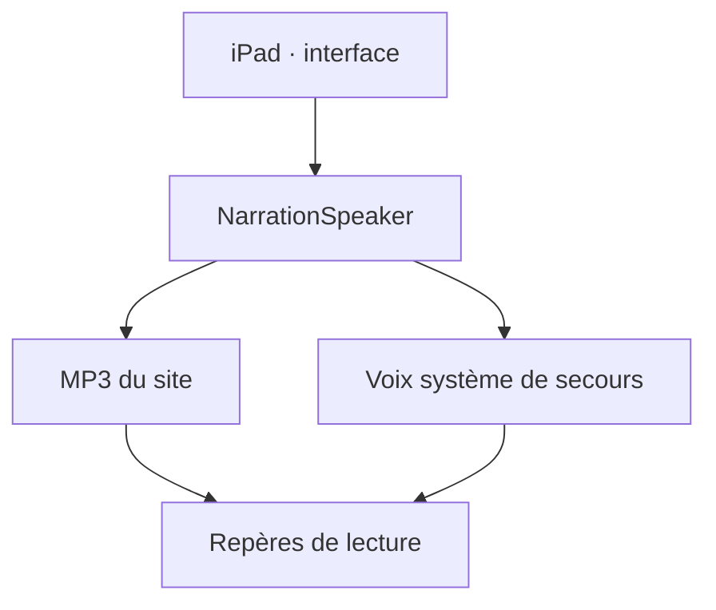

# Architecture de l’Atelier des mots

Référence technique au 22 octobre 2026. État opérationnel daté : [PROJECT-STATE](ops/PROJECT-STATE.md). Accès et exploitation : [ACCESS-RUNBOOK](ops/ACCESS-RUNBOOK.md).

## Périmètre et hébergement

| Élément | Référence | Rôle |
|---|---|---|
| Dépôt actif | Lianag2018/educ-ecole, main | Source de l’application personnelle |
| Site | https://educ-ecole.vercel.app | Interface et endpoints API sur la même origine |
| Équipe Vercel | lianag2018s-projects | Hébergement personnel |
| Projet Vercel | educ-ecole | Projet de production, pas educ-ecole-famille |
| Supabase personnel | Identité distante à vérifier | Auth parent, sauvegardes et budget vocal prévus |
| Render personnel | Service actif non confirmé | Aucune dépendance Render démontrée pour la lecture publiée |
| Ancienne source | kenebec-ai/projects/lecture-famille | Provenance historique, pas source active |

Aucun besoin de MongoDB n’est établi dans le code actuel. Ne pas créer une deuxième base ou un deuxième hébergement pour résoudre un défaut d’accès.

## Parcours de lecture

- `src/app.js` : navigation, profils, activités, réponses, commandes audio et affichage.
- `src/engine.js` : sélection/révision et persistance locale. `src/learning.js` : différenciation des niveaux scolaires.
- `src/content.js`, `garden.js`, `unicorn-stories.js`, `week-plan.js` : activités, histoires et plan scolaire; `numbers.js` : nombres.
- `src/narration.js` : MP3 publics déjà générés, annulation des callbacks anciens, voix système si fichier absent.
- `src/speech.js` : lecture native fr-CA et suppression du séparateur « + » uniquement pour les syllabes.
- `src/guided-reading.js` : ponctuation, liaisons choisies, surlignage piloté par le média; estimation pour MP3, événements de mots lorsqu’une voix native les fournit.
- `src/style.css` : interface et effets; respecte la réduction des animations. `icons/accueil-famille.png` : accueil illustré conservé.

Les profils p1 (1re année) et p2 (3e année) ont des activités et progrès distincts. La plage de nombres demandée au profil avancé est 0–1 999. Le plan scolaire peut demander une plage plus large; ne pas annoncer cette extension tant qu’elle n’est pas implémentée.

## Production de la narration

`ops/build.mjs` construit `dist`, puis `ops/generate-narration.mjs` utilise le catalogue borné de `ops/narration-catalog.mjs`. La génération payante n’est autorisée par ce code qu’en build Vercel de production sur main. Elle réutilise les fichiers existants; ne pas lancer plusieurs builds payants simultanément.

Le catalogue est borné par `ops/narration-catalog.mjs`, avec modèle, voix et instructions fixés dans le code. Le statut publié fait foi pour la disponibilité réelle. `/audio/manifest.json` associe textes pédagogiques et fichiers. `/audio/status.json` indique ready/partial/unavailable et les compteurs. Un clic sur Écouter lit un fichier existant; il ne génère pas une nouvelle facture OpenAI. Les textes privés importés ne deviennent pas automatiquement des MP3 publics.

## Conversation et données

La conversation libre est distincte de la lecture :
`src/conversation.js` → endpoints `api/parent/*` et `api/voice/*` → `ops/server/runtime.mjs` → vérification parent, budget durable et fournisseur.

Les modules `session.mjs`, `budget.mjs`, `turn.mjs`, `provider.mjs`, `pedagogy.mjs` portent les responsabilités serveur. Les migrations `ops/supabase/001-parent-backups.sql` et `002-voice-budget.sql` sont préparées; leur présence ne prouve pas leur application distante. Voir VOICE-SETUP pour les variables et conditions exactes.

| Donnée | Conservation actuelle / limite |
|---|---|
| Profils, progrès, cartes locales | localStorage du navigateur; pas de synchronisation automatique démontrée |
| Enregistrement pour réécoute | Mémoire locale, libéré à la sortie; pas une évaluation automatique |
| MP3 narratrice | Fichiers publics de textes intégrés |
| Secrets fournisseur | Environnement serveur/build uniquement |
| Budget conversation | SQL durable requis avant activation; plafond configuré 40 CAD/mois |
| Audio/transcription conversation | Traitement serveur conditionnel; protections et rétention à vérifier avant usage réel |

Installation sur écran d’accueil via manifest et icônes; aucun service worker ni fonctionnement hors ligne garanti.

## Retour oral borné et accompagnement — 22 octobre 2026

`src/oral-check.js` porte un contrôleur persistant séparé de la conversation. L’interface peut être remontée après une lecture sans perdre l’essai courant. Chaque changement de cible annule l’essai; profil, navigation, arrière-plan et déconnexion retirent aussi l’attestation adulte. Le panneau mot est replié au nouvel essai; sa fermeture arrête le micro. Les autres lecteurs, le studio et la conversation sont arrêtés avant une capture. Un état ou une réponse périmée ne s’applique pas à une nouvelle activité.

La capture utilise AudioWorklet, avec secours ScriptProcessor si nécessaire, et produit un WAV PCM mono 24 kHz limité à huit secondes côté client. Les pistes sont fermées avant l’envoi. Aucun Web Speech Recognition tiers implicite n’est utilisé. La présence adulte est une attestation renouvelée au plus tard après quinze minutes, ajoutée à la connexion parent réelle; elle n’est pas une détection physique de présence.

`src/oral-check-targets.js` partage la liste des dix mots intégrés, les nombres autorisés et les trois retours fixes. `/api/voice/check` passe par `runtime.mjs` puis `oral-check.mjs` : authentification Supabase, origine exacte, propriété du profil, attestation récente, configuration vérifiée, validation WAV et réservation durable avant un seul appel `gpt-transcribe`. La cible attendue n’est pas envoyée à OpenAI. Le serveur accepte au plus dix secondes et ne renvoie ni transcription brute ni score phonétique. Pas de retry payant automatique, de chat ou de TTS à chaque essai : les retours fixes utilisent la narration préenregistrée.

Le résultat se limite à une réponse reconnue, une autre réponse connue ou un résultat incertain. La liste explicite des nombres tolère les pluriels écrits silencieux de cent/vingt; elle n’accepte pas un calcul, un nombre signé ou une phrase arbitraire comme réponse numérique positive. Un signal proche du silence numérique est écarté avant appel; cela ne constitue pas une détection de voix ou d’identité. Aucun résultat STT ne crédite le moteur, un PDF ou une ligne.

`/api/voice/status` conserve `available` pour la conversation et ajoute `authConfigured`, `oralCheckAvailable` et `oralCheckReason`. Ces statuts de configuration ne prouvent pas un test réel du fournisseur ou des migrations. `VOICE-SETUP.md` précise le blocage d’accès personnel et les conditions d’activation.

`src/learning-coach.js` fournit uniquement des aides facultatives : représentation du nombre, colonnes de position adaptées, zéro conservé, décomposition, comparaison, explication d’un mot et phrase personnelle. Les questions ne valident rien automatiquement. Le panneau parent distingue pratique accompagnée, observation et évaluation professionnelle.

## Observations quotidiennes et reprise des données — 22 octobre 2026

`dailyEvidence` regroupe au plus une observation par carte/domaine/jour et conserve l’aide ou l’erreur précédant une réussite. `answer` retourne ce résultat effectif; la mission l’emploie pour son retour et son crédit. Tous les essais restent présents, avec `submittedResult` lorsque nécessaire. Les anciens sujets nommés par compétence sont interprétés comme Français; Maths reste séparé.

Les paliers utilisent au plus quatre observations : palier 2 à partir de deux jours et 75 % sans aide signalée; palier 3 avec quatre réussites sur trois jours et deux cartes. Révisions 1/3/7/14 jours selon les journées réussies distinctes. Ces seuils sont des règles du produit. Le tri respecte `order` des fondations; les révisions dues gardent leur priorité.

Au chargement, seuls les champs dérivés `streak`, `result`, `due` des cartes documentées sont repris. Les entrées historiques non exploitables sont conservées mais ignorées pour le calcul. Aucun reset des profils, des PDF, des autres champs ou de l’historique n’est nécessaire. Le rapport parent utilise « sans aide signalée » et ne constitue pas un diagnostic. Voir [l’audit daté](ops/AUDIT-PEDAGOGIQUE-2026-10-22.md).

## Validation et livraison

`npm test` et `npm run build` constituent les contrôles locaux. Les tests SQL exigent une base jetable explicitement identifiée; ne pas lancer des fixtures sur la base familiale. Les tests mock ne prouvent ni l’acoustique réelle ni une configuration distante.

Publier l’application complète avec ses fonctions API, pas seulement une ancienne preview statique. Confirmer projet/équipe/SHA, état du build, HTTP des ressources, lecture réelle et interruption. Mettre les preuves dans PROJECT-STATE sans secrets. Conserver la version de production précédente pour retour arrière; ne pas réinitialiser les données des enfants.

## Mémoire pédagogique — ajout du 21 octobre 2026

`src/progress.js` recalcule un portrait par profil depuis l’historique existant : fenêtres de sept jours, réussites sans aide, aides, reprises et prochaine étape. La classification de consolidation exige plusieurs jours et cartes; les répétitions du même jour/carte sont regroupées pour cette classification. Il s’agit de règles explicites, pas d’un diagnostic ni d’une IA qui se réentraîne.

Les nouvelles réponses incluent la matière et le niveau de l’activité. Les réponses Maths/Univers social ne changent plus le palier de lecture. Les anciennes réponses sans matière restent conservées et signalées non classées dans le bilan; la compatibilité de leur ancien calcul de niveau est conservée. La mission de français classe les domaines selon les besoins, tout en gardant les échéances et limites existantes. Les matières ouvertes explicitement commencent par les reprises dues, puis les nouveautés, sans retirer de contenu ni changer l’année scolaire. Cette adaptation utilise la banque existante, sans générer de nouveaux exercices.

Le bilan est recalculé après les réponses lors de son affichage et ne nécessite aucun appel réseau. Persistance locale existante, pas de synchronisation distante livrée. Pas de mise à jour autonome du code : les changements logiciels restent testés et revus.

## Jardin des sons — préparation locale du 22 octobre 2026

`src/sound-garden.js` fournit les 36 cartes. `src/phoneme-player.js` joue exclusivement les MP3 importés de Laval, à vitesse originale, et invalide les événements des lectures précédentes. `icons/phonemes/sources.json` conserve la provenance et les empreintes des fichiers; le build les copie avec les icônes. Aucun service payant, microphone ou synthèse de phonème n’est appelé. Les récompenses d’effort restent distinctes de la maîtrise en lecture. État de validation et de publication dans PROJECT-STATE.

## Sprint et plans photographiés — 22 octobre 2026

`src/speed-math.js` : dix cartes, trois choix uniques, temps actif monotone, pause sur changement d’onglet. Trois paliers (20/15/10 secondes indicatives). Cinq réussites dont quatre dans le repère permettent une montée; deux erreurs/aides ou trois lenteurs dans un bloc de cinq permettent une baisse. Jamais d’échec automatique au délai. Résultats séparés dans chaque profil; pas de diagnostic de maîtrise.

`src/math-speech.js` normalise nombres et calculs simples en mots français. `56 − 20` devient « cinquante-six moins vingt ». Les instructions de narration ont été révisées pour toute la banque, avec un complément numérique. Les fichiers ont une nouvelle empreinte; la publication doit confirmer 1 132 clips. L’existence d’un MP3 ne prouve pas à elle seule la qualité acoustique.

`src/school-plan.js` : formulaire photo, réduction JPEG locale (1 600 px), extraction limitée aux notions, plans datés isolés par profil, génération déterministe de calculs et cartes de mots et sélection de contenus d’univers social déjà préparés. Les thèmes non pris en charge et pages manquantes sont affichés explicitement. Il n’y a ni import automatique des livres CEC, ni renouvellement autonome du code.

`ops/server/plans.mjs` et `/api/plans/import`, `/api/plans/list` : parent authentifié, profil détenu, consentement par photo, configuration de rétention vérifiée, budget durable partagé, requête OpenAI à endpoint fixe (aucun outil), sortie structurée validée puis sauvegarde privée. Une réserve prudente de 1 CAD par import (pas le coût réel) reste comptabilisée; les requêtes répétées dont le résultat est sauvegardé utilisent le cache. Pas de nouvelle tentative payante automatique. Au plus 12 plans par profil. Photo non conservée par l’app; la rétention fournisseur dépend de la configuration vérifiée.

**Activation non démontrée** : schéma `ops/supabase/school-plans-schema.sql` proposé, non appliqué. Exige les profils et le budget existants, les variables personnelles et `plansEnabled:true` dans la configuration uniquement après vérification effective des conditions. Aucune valeur de consentement/rétention ne doit être falsifiée. Connexion parent indépendante de la disponibilité vocale. Les plans peuvent être récupérés sur un autre appareil une fois le service configuré; les historiques de réponses restent locaux, sans synchronisation automatique.

## Fiches familiales et parcours — 22 octobre 2026

`src/family-library-data.js` décrit 78 PDF officiels Alloprof et leurs pages utiles, après analyse de 426 pages. Il ne contient aucun PDF. `family-library-p1-data.js` et `family-library-p2-data.js` définissent six parcours, 49 petites étapes et les supports enfant/parent. Les ressources familiales ont des consignes et pages différentes selon le profil. Neuf documents plus avancés restent dans « Pour plus tard »; les erreurs de source repérées sont signalées au parent sans modifier les originaux.

`family-library-paths.js` conserve `profile.familyLibraryProgress` avec point de départ, dernier repère de chaque étape et reprise explicite. Le parent seul confirme le passage; une ouverture, un temps passé ou un lancement de jeu ne vaut pas réussite. Les activités liées réutilisent la banque du profil et les matières existantes. L’historique de lecture n’est ni remplacé ni artificiellement crédité par les fiches.

`family-library.js` et son CSS affichent d’abord l’étape courante, puis le catalogue replié. Les liens officiels et locaux portent la première page prévue dans l’ordre pédagogique; les guides et corrigés restent repliés. L’import est disponible dans l’espace parent. Les données et copies sont locales au navigateur et à l’origine du site.

`family-library-store.js` valide le ZIP par son répertoire, les empreintes NFC des chemins, les tailles et SHA-256 des PDF. Il ignore l’HTML et le manifeste inclus, refuse les archives incomplètes/étrangères et borne la décompression. `src/vendor/fflate.js` est la version navigateur 0.8.2, licence MIT jointe, sans CDN. Une transaction IndexedDB remplace les 78 documents après validation complète; échec ou annulation conserve l’ancienne bibliothèque. Les liens Blob sont préparés avant l’ouverture et libérés ensuite. Les profils peuvent être réinitialisés séparément des copies PDF.

Le correctif de `ops/narration-catalog.mjs` marque explicitement les contenus numériques. `ops/align-narration.mjs` les exclut de l’alignement des textes de lecture, même après mise en mots : 52 candidats, sous la limite existante de 80, sans changer les empreintes audio.

## Lecture des nombres avec les extraits PédagoFA — 22 octobre 2026

`src/number-audio-data.js` associe 40 nombres à leurs URL MP3 officielles CSSDM, avec provenance et empreintes. `src/number-audio.js` reconnaît seulement des nombres 0–1 999, leurs formes françaises complètes, des lignes de nombres ou des calculs simples. Il ne remplace aucun mot au milieu d’une histoire. Une expression de la forme 21-10 conserve le sens de soustraction du module `math-speech.js`; les dates complètes et téléphones ne sont pas acceptés comme plans numériques.

Le planificateur choisit d’abord les extraits entiers disponibles, puis des compositions explicites. Il ne colle pas le vingt isolé devant une unité pour 21–29, n’ajoute pas de et à 81/91 ou après cent/mille, et conserve les blocs entiers de narration nécessaires pour les centaines sensibles. Les opérateurs disposent de sept clips dédiés dans le catalogue existant. Le plan de secours utilise uniquement les fichiers de narration du site.

`NarrationSpeaker` résout le plan numérique avant un éventuel calcul entier déjà enregistré. La sélection explicite de la voix système reste disponible. Un même élément HTMLAudio lit la séquence; le premier `play()` reste dans le geste utilisateur. Les gardes de lecture et de segment écartent les callbacks périmés. Vitesse et hauteur sont conservées, arrêt/nettoyage annulent le chargement, une panne distante autorise au plus une reprise du plan entier avec la banque locale. Le suivi des séquences numériques reste approximatif; les repères mesurés des récits sont conservés.

La politique `media-src` autorise uniquement l’origine HTTPS `pedagofa.cssdm.gouv.qc.ca` en plus des médias du site et des Blob existants. `connect-src` demeure limité au site : les MP3 sont lus par HTMLAudio sans fetch tiers, sans cookies ajoutés par l’application, sans envoi de texte libre ni de microphone. Aucun import, copie distante ou génération payante au clic. La modification du catalogue ajoute sept opérateurs et conserve toutes les empreintes des 1 132 clips antérieurs.

Références linguistiques : [vingt](https://vitrinelinguistique.oqlf.gouv.qc.ca/23141/la-prononciation/prononciation-des-nombres/prononciation-de-vingt), [et dans les nombres](https://vitrinelinguistique.oqlf.gouv.qc.ca/24631/la-prononciation/prononciation-des-nombres/prononciation-de-et-dans-les-nombres-composes), [six et dix](https://vitrinelinguistique.oqlf.gouv.qc.ca/23137/la-prononciation/prononciation-des-nombres/prononciation-de-six-et-dix), [huit](https://vitrinelinguistique.oqlf.gouv.qc.ca/23149/la-prononciation/prononciation-des-nombres/prononciation-de-huit), OQLF, consultées le 22 octobre 2026. Le choix des blocs ne constitue pas une validation de la voix, de chaque enchaînement ou de la prosodie par écoute humaine.

## Passeport magique — 26 octobre 2026

`src/voyage.js` et `voyage.css` ajoutent quatre escales imaginaires, des histoires
originales adaptées p1/p2 et des coquillages SVG dénombrables. Les activités
existantes restent accessibles sous la carte. L’illustration WebP dérive des
visages approuvés; aucune nouvelle dépendance vidéo ni génération à chaque clic.
Les mouvements sont finis, désactivables et respectent reduced-motion.

Les étoiles sont recalculées depuis les réponses correctes existantes : cinq par
carte/matière/jour, jamais par simple ouverture. Les erreurs/aides conservées par
le moteur ne deviennent pas des réussites autonomes. Les étoiles ne sont pas un
score de maîtrise. `profile.voyage` conserve seulement destination, pause,
confirmations parent et récompenses. Les profils et anciennes données sont préservés.

Le bilan agrège toutes les tâches du plan importé de la semaine et les tâches
manuelles avec échéance dans cette semaine, y compris les pages non prises en
charge. Chaque tâche doit être confirmée dans l’espace parent. Les ailes sont
attribuables dès dimanche à Toronto ou pour une semaine passée, une seule fois.
Un plan vide ne qualifie pas. Le texte changé d’une tâche invalide sa confirmation.
Les récompenses déjà remises restent historiques. L’espace parent n’est pas un
contrôle d’identité; aucune promesse de validation scolaire automatique.

## Aventure du trésor — 26 octobre 2026

`src/dominican-adventure.js` contient trois chapitres de fiction originaux
(bateau, jardin de palmiers, plage) et neuf activités par profil. La lecture
précède le calcul puis l’indice, même au rejeu; le reste de la banque conserve
son ordre adaptatif habituel. p1 : phrases courtes, dessins SVG dénombrables et
repérage de mots. p2 : compréhension, dizaines/unités, ordre des actions,
référence pronominale et résumé. Les dessins à compter restent immobiles.

`src/voyage.js` présente ce parcours en priorité; les anciens petits contes
restent disponibles dans un volet secondaire. Illustration WebP dérivée de
références familiales, sans photographies originales ni métadonnées de voyage
dans le dépôt. Une étape explorée n’est pas une maîtrise acquise. Les étoiles
et le plan hebdomadaire conservent leurs règles et leurs données par profil.

## Scènes manipulables — 26 octobre 2026

`illustrated-games.js` adapte les cartes existantes sans modifier leur identifiant,
réponse ou historique. Collections : 0–20 graines; additions/soustractions :
collections de 24 objets maximum; groupes ×/÷ : 12 × 12 maximum et division exacte.
Les expressions hors contrat gardent leur présentation existante. Six nouvelles
cartes de groupes sont réservées au profil avancé. Les actions sur les groupes
signalent une aide; aucune manipulation ne crédite une réussite à elle seule.
`session.scene` garde les objets touchés pendant les mises à jour, puis est vidé au
changement de carte. Le démontage retire les écouteurs. La narration utilise
`updateAudioSurface` et ne reconstruit plus les jeux à chaque changement de statut.
La navigation et les réponses conservent pour le moment le rendu général existant.
Le CSS partagé respecte la pause de voyage et la réduction des animations.
Cette première tranche couvre les objets de maths, pas encore tous les lecteurs.
